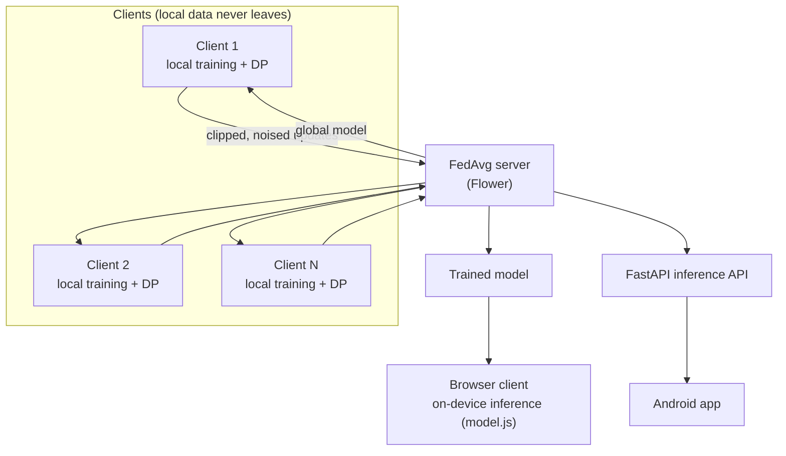

<div align="center">

# 🛡️ Privacy-Preserving Federated Symptom Checker

**A diagnostic assistant trained with Federated Learning and Differential Privacy, so raw patient data never leaves the client, and symptom checks run entirely in the browser.**


</div>

<br />


---

## Overview

Medical data is among the most sensitive data there is, which makes it hard to centralize for training. This project trains diagnostic models with **Federated Averaging**: each client trains on its own data and shares only model updates. It adds **Differential Privacy** (per-sample gradient clipping plus calibrated Gaussian noise) to bound what those updates can reveal. The trained symptom model is shipped to the **browser**, so predictions run on-device as well.

It covers three modalities:

| Modality | Dataset | Model | Input |
|---|---|---|---|
| Tabular symptoms | Kaggle Disease–Symptom (4,920 records, 41 diseases, 132 symptoms) | 3-layer MLP | Binary symptom vector |
| Skin conditions | HAM10000 | MobileNetV3-Small | 224×224 RGB image |
| Respiratory sounds | ICBHI 2017 | Small CNN | 128×128 Mel spectrogram |

## Architecture



## Results

All numbers below are reproduced from the code in this repository. [`docs/paper_claims_ledger.md`](docs/paper_claims_ledger.md) tracks every claim against its evidence.

**Tabular symptom model** (10 clients, Dirichlet α = 0.5 non-IID split, 10 rounds, δ = 10⁻⁵):

| Setting | Test accuracy |
|---|--:|
| Centralized (no privacy) | 100% |
| FedAvg, no DP | 99.8% at round 2, 100% from round 4 |
| FedAvg + DP, ε = 5.0 | 38.4% |
| FedAvg + DP, ε = 2.0 | 23.6% |
| FedAvg + DP, ε = 1.0 | 3.4% |
| FedAvg + DP, ε = 0.5 | 4.7% |

Strict privacy budgets cost a lot of accuracy on a 4.9K-record dataset split across 10 clients. Quantifying that privacy–utility tradeoff is the point of the experiment.

**On-device inference:** `client-app/model.js` runs the ε = 5.0 model in pure JavaScript. It matches PyTorch's prediction on all **984/984** test samples, with a maximum logit difference of 1.7×10⁻⁵.

**Skin (HAM10000), centralized:** 86.0% test accuracy, macro-F1 0.80, with a pretrained MobileNetV3-Small. Federated and DP runs for the skin and respiratory branches are still in progress.

## Getting started

```bash
pip install -r requirements.txt

# Datasets
python data/download_datasets.py
python data/preprocess_tabular.py      # also: preprocess_skin.py, preprocess_respiratory.py

# Reproduce the tabular results table (centralized vs. FedAvg vs. FedAvg + DP)
python benchmarks/real_comparison_experiment.py

# Flower-based federated simulation
python server/run_simulation.py --model symptom_mlp --num_clients 10 --rounds 20 --epsilon 2.0

# Baselines and privacy–utility sweep
python server/centralized_baseline.py --model symptom_mlp
python server/fl_no_dp_baseline.py --model symptom_mlp --num_clients 10 --rounds 20
python benchmarks/privacy_utility_sweep.py --model symptom_mlp
python benchmarks/plot_results.py
```

**Web client:** run `npx serve client-app` and open the printed URL. The symptom checker works fully offline. The skin and respiratory modules need the inference API, which you start with `python server/api_server.py`.

**Android client:** open `android-app/` in Android Studio.

## Testing

```bash
pytest tests/                          # model + preprocessing tests
node tests/js/model_parity.test.js     # browser model vs. PyTorch parity
```

## Project structure

```text
data/         dataset download, preprocessing, non-IID partitioning
models/       symptom MLP, skin CNN, respiratory CNN
federated/    Flower client/server, FedAvg strategy, DP configuration
server/       simulation runner, baselines, FastAPI inference server
benchmarks/   experiments, privacy–utility sweep, plots
deployment/   model export + inference benchmarks
client-app/   web client with in-browser inference
android-app/  native Android client
tests/        Python and JS tests
docs/         paper claims ledger
```

## Team

| Member | Responsibility |
|---|---|
| **Rohan Tiwari** | Federated coordination and server aggregation (Flower / FedAvg) |
| Saar Ravindra Singh | Client-side model development and on-device deployment |
| Saksham Garg | Differential Privacy integration (Opacus) and benchmarking |

**Mentor:** Dr. Jaishree Jain, Department of CSE, AKGEC Ghaziabad

This repository is Rohan's working copy of the team project ([original repository](https://github.com/saarcasm/Federated-Symptom-Checker)). It extends the project with:

- an exact reproduction of the paper's tabular results;
- in-browser inference with a PyTorch parity test;
- removal of mock prediction fallbacks from the web and Android clients;
- skin and respiratory experiments;
- a claim-by-claim verification ledger.

## References

1. McMahan et al., *Communication-Efficient Learning of Deep Networks from Decentralized Data*, AISTATS 2017
2. Rieke et al., *The Future of Digital Health with Federated Learning*, npj Digital Medicine 2020
3. Yousefpour et al., *Opacus: User-Friendly Differential Privacy Library in PyTorch*, 2021
4. Dwork, *Differential Privacy*, ICALP 2006
5. Beutel et al., *Flower: A Friendly Federated Learning Framework*, 2020
6. Tschandl et al., *The HAM10000 Dataset*, Scientific Data 2018
7. Rocha et al., *ICBHI 2017 Challenge Respiratory Sound Database*, 2017
8. Kaggle, *Disease Symptom Prediction* dataset
